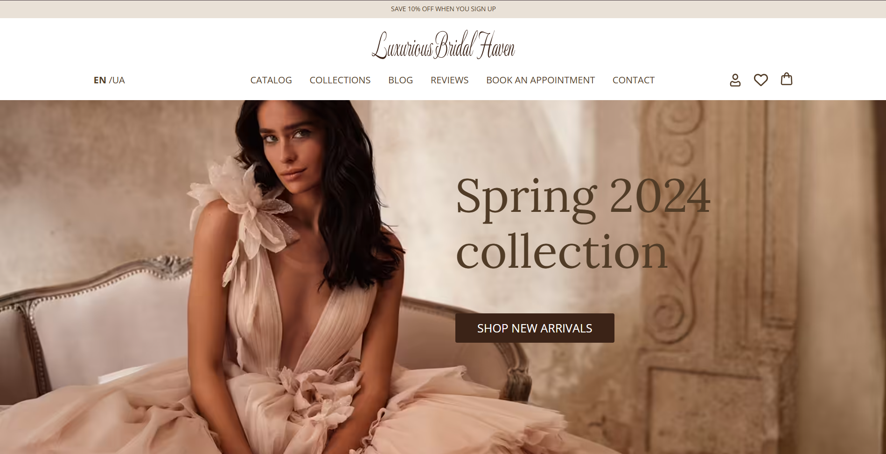

# Luxurious Bridal Haven

Многостраничный сайт салона свадебных платьев. Учебный проект: адаптивная вёрстка по макету, сборка на Gulp.

**[Открыть сайт](https://drozdtatsiana.github.io/luxurious-bridal-haven/)**



## Страницы

- Главная
- Каталог с фильтрами и ползунком цены
- Коллекции
- Страница товара
- Оформление заказа (демо, платежи не работают)
- Блог и страница статьи
- Отзывы
- Запись на примерку
- Страница 404

## Что реализовано

- адаптивная вёрстка: десктоп, планшет, мобильные устройства
- методология БЭМ, SCSS, сборка на Gulp
- слайдеры на Swiper, ползунок цены на noUiSlider
- мобильное меню, попап фильтров, окно корзины
- переключение вида товаров: сетка и список
- изображения в форматах AVIF и WebP, SVG-спрайт
- семантическая вёрстка, подписи для кнопок и форм, доступная навигация с клавиатуры

## Технологии

HTML5, SCSS, JavaScript, Gulp, Swiper, noUiSlider

## Запуск проекта

```bash
npm install
gulp
```

Сборка проекта: `gulp build`

Публикация на GitHub Pages: `npx gh-pages -d dist`
